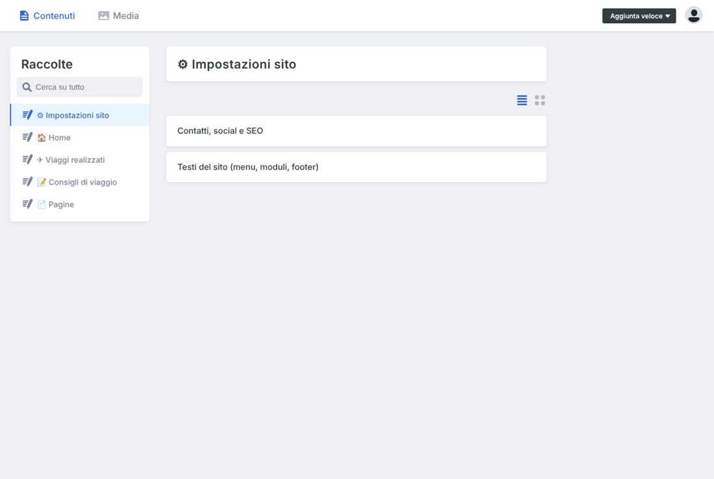
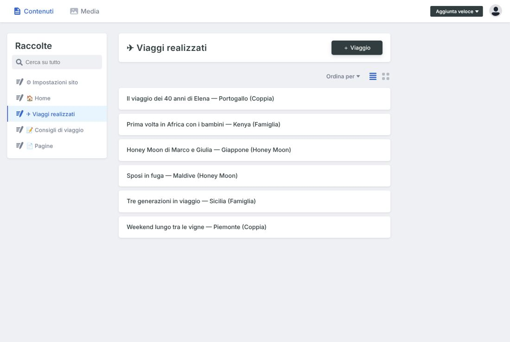
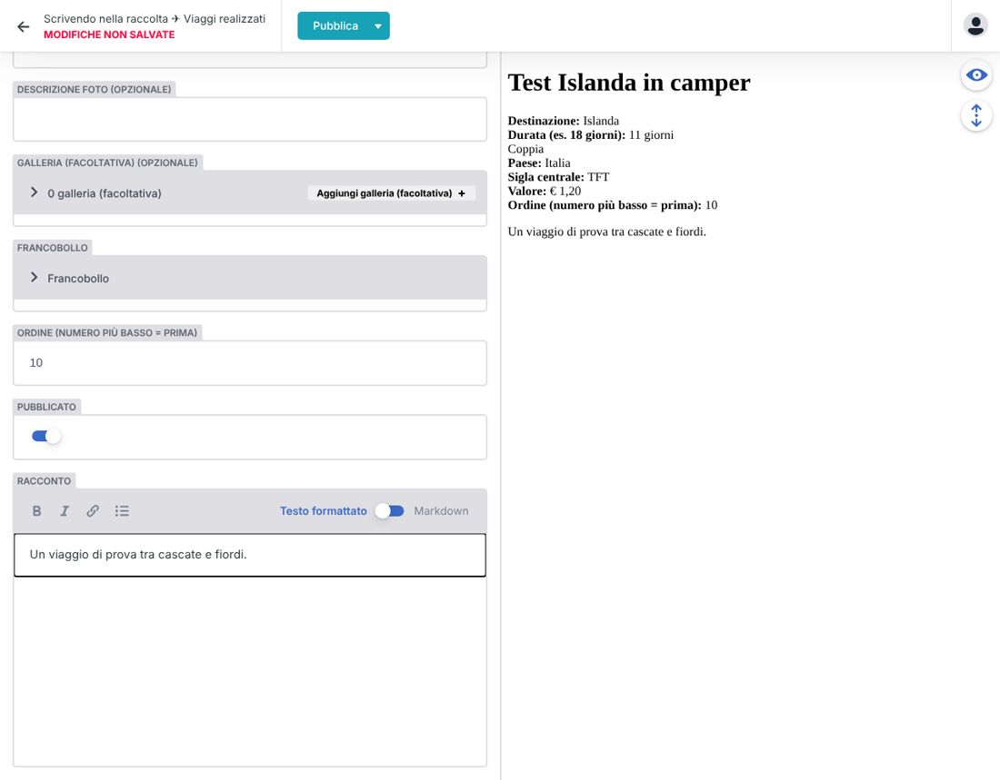
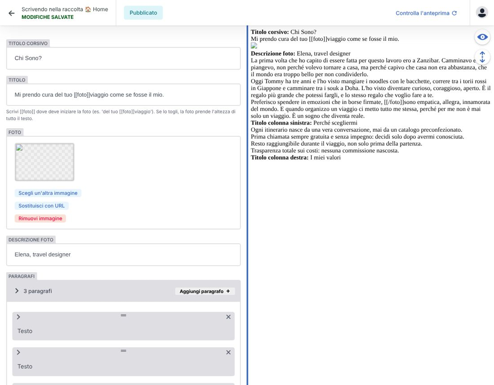

# Guida al sito — per Elena

Questa guida spiega come cambiare testi, foto e viaggi del sito senza toccare codice.

## 1. Entrare

1. Vai su **tuodominio.it/admin**.
2. Clicca **Accedi con GitHub** e usa il tuo account GitHub. Le volte successive di solito sei già dentro.

A sinistra trovi le **raccolte**, cioè le parti del sito:

| Raccolta | Cosa contiene |
|---|---|
| ⚙ Impostazioni sito | telefono, email, WhatsApp, social, P.IVA, testi del footer, titolo e descrizione per Google; anche i "Testi del sito" (menu, etichette del modulo) |
| 🏠 Home | una voce per ogni sezione della pagina: apertura con video, Chi sono, Servizi, Come funziona, Nozze, Famiglia, Recensioni, Contatti |
| ✈ Viaggi realizzati | le cartoline del carosello, una per viaggio |
| 📝 Consigli di viaggio | gli articoli del blog (la sezione in home è spenta finché non la accendi) |
| 📄 Pagine | Privacy Policy e Cookie |

## 2. Modificare un testo

1. Apri la raccolta e poi la voce (es. **Home → Servizi**).
2. Cambia il testo nei campi a sinistra: a destra vedi un'anteprima semplice (non è l'aspetto finale del sito).
3. Clicca **Pubblica** in alto → **Pubblica ora**.

**Dopo circa 1 minuto** la modifica è online: il sito si ricostruisce ogni volta che pubblichi. Se non la vedi, ricarica la pagina tenendo premuto Maiusc.

> Consiglio: fai tutte le modifiche di una voce e poi pubblica una volta sola. Ogni pubblicazione è una ricostruzione del sito.

## 3. Aggiungere un viaggio

1. **✈ Viaggi realizzati** → **+ Viaggio**.

2. Compila:
   - **Titolo**, **Destinazione**, **Durata** (es. "12 giorni").
   - **Categoria**: scegli dall'elenco. Per creare una categoria nuova vai prima su **Home → Viaggi realizzati (titoli e categorie)**.
   - **Foto copertina** e la sua **descrizione** (una frase su cosa si vede: serve a chi non vede le immagini e a Google).
   - **Galleria** (facoltativa): altre foto, si sfogliano nel racconto.
   - **Francobollo**: paese, sigla e valore stampati sul francobollo della cartolina. L'anno del timbro, se lo lasci vuoto, è l'anno in corso.
   - **Ordine**: numero più basso = cartolina più a sinistra.
   - **Racconto**: il testo che si apre cliccando sulla cartolina.
3. **Pubblica → Pubblica ora**.

Per **nascondere** un viaggio senza cancellarlo spegni **Pubblicato**. Per cancellarlo: apri il viaggio → **Elimina voce**.

## 4. Cambiare una foto

1. Apri la voce (es. **Home → Chi sono**).
2. Sul campo della foto clicca **Scegli un'altra immagine** → **Carica** e scegli il file dal telefono o dal computer.
3. Pubblica.

Le foto possono essere pesanti: il sito le rimpicciolisce da solo. Due regole:
- Formati: **JPG o PNG**. Le foto **HEIC** dell'iPhone non vanno bene: su iPhone vai in *Impostazioni → Fotocamera → Formati → Più compatibile*, oppure condividile come JPG.
- Video di apertura: **MP4**, al massimo 6 MB.

### La foto di "Chi sono"

La foto è allineata al testo con due segni:
- `[[foto]]` nel **titolo**: lì comincia la foto (oggi prima della parola "viaggio");
- `[[/foto]]` in un **paragrafo**: lì finisce (oggi prima di "sono empatica").

Puoi spostarli nel testo. Se li cancelli entrambi, la foto prende l'altezza di tutto il testo.

## 5. Recensioni

**Home → Recensioni → Aggiungi recensione**: testo, nome, viaggio e stelle (da 1 a 5).
Pubblica solo **recensioni vere, con il permesso di chi le ha scritte**: le recensioni inventate sono vietate dalla legge (Codice del Consumo). Se l'elenco è vuoto, la sezione sparisce dal sito.

## 6. Richieste dal modulo di contatto

Le richieste arrivano via email a **theflowerstravel@gmail.com**. Contengono le risposte alle domande, nome, email, telefono (se lo lasciano) e il consenso privacy.
Le domande del modulo si cambiano in **Home → Contatti → Domande del modulo**.

Gli iscritti alla newsletter si trovano nel pannello di Netlify, alla voce **Forms → newsletter**.

## 7. Se qualcosa va storto

- **La modifica non compare dopo qualche minuto**: probabilmente un campo non è valido (es. una foto in formato HEIC). In quel caso il sito **resta com'era**: non si rompe niente. Arriva un'email di avviso: inoltrala a chi segue il sito tecnicamente.
- **Voglio tornare alla versione precedente**:
  - di un testo: riapri la voce, rimetti il testo di prima e pubblica;
  - di tutto il sito: su Netlify → **Deploys** → scegli una versione precedente → **Publish deploy**. È immediato.
- Ogni pubblicazione è salvata nella cronologia (GitHub), quindi nulla va perso.
